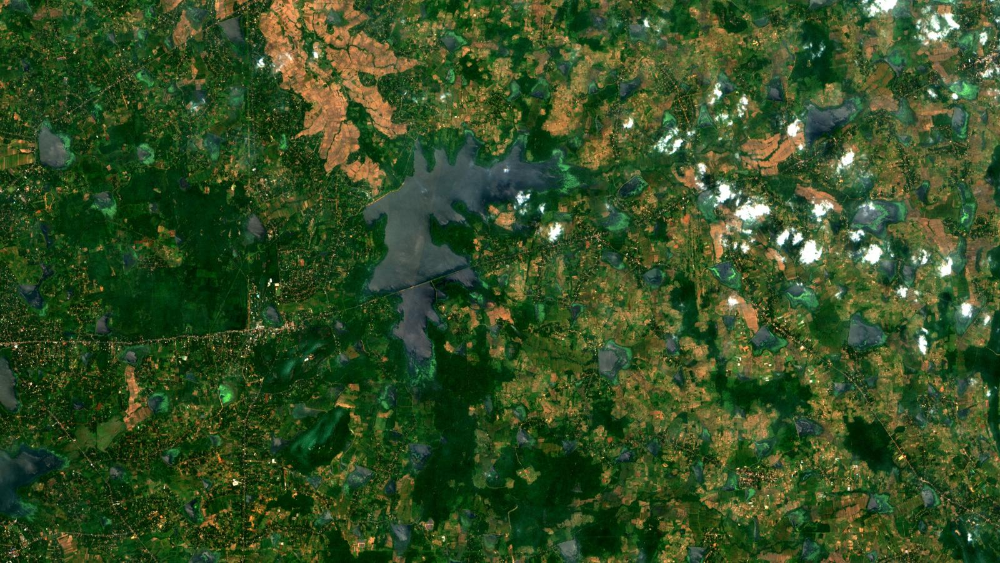
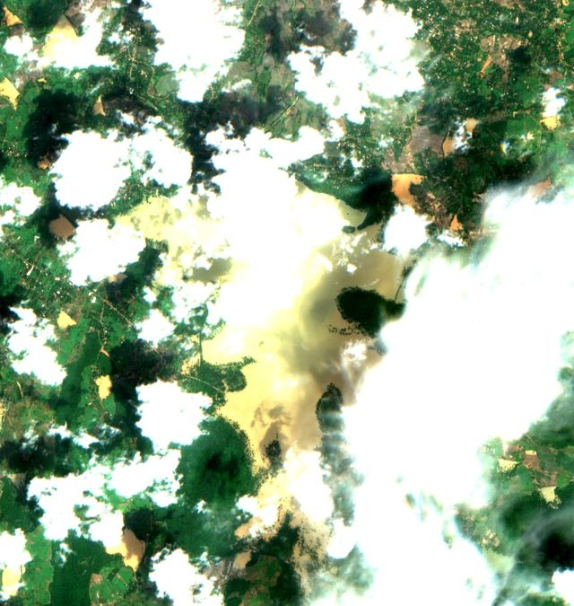
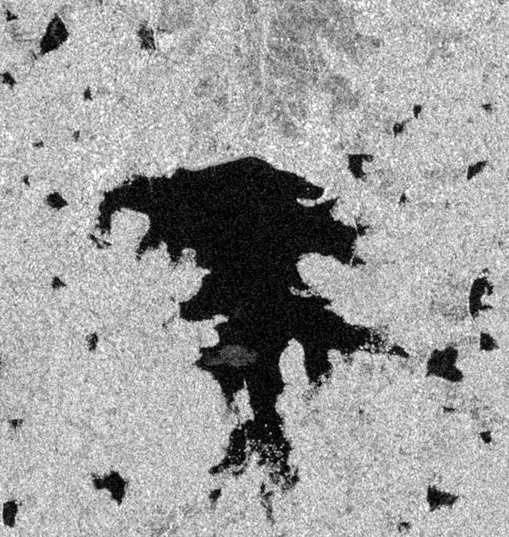

# JARVIS

**IS4990 Comprehensive Group Project · Group 6 · University of Moratuwa**

How much water do Sri Lanka's tanks hold today? We are building a way to answer that from free satellite data, under cloud too.

## SWOT Tank Water Tracker for Sri Lanka

- **Height:** the SWOT satellite (NASA and CNES) measures each tank's water level.
- **Area:** AI water maps from Sentinel-1 radar and Sentinel-2 photos measure the water's extent, under cloud too.
- **Storage:** together, the height and the area give each tank's storage every 5 to 12 days, checked against the Irrigation Department's daily records.

| Module | Research question | Focus |
|---|---|---|
| A | RQ1 | Water maps under cloud |
| B | RQ2 and RQ3 | SWOT heights and storage |
| C | RQ4 | Forecast and the system |

## Why radar

  
  

Hurulu Wewa in the monsoon. Cloud hides the photo (Sentinel-2, 30 Nov 2025), while radar still shows the water in black two days later (Sentinel-1, 2 Dec 2025).

## Latest (4 Nov 2026)

- **Under cloud, only radar works.** At about 100 reservoirs, our radar U-Net reads storage within 11 to 12% of capacity, against 14% for the seasonal average and 20 to 22% with no model.
- **Retrained on our own reservoirs** (two runs, 103 reservoirs, rules fixed in advance), it reads storage within about 8% of capacity, against 11% for the model it started from, and it beats the last clear photo at 81% of reservoirs. It still loses some flood-mapping skill on an outside test, so by our own rules it is not yet a win.
- **Checked against expert water maps:** on 15 scenes of the public S1S2-Water dataset that it never saw, the retrained model maps water at IoU 60 (F1 75), against 53 before retraining and 34 for a simple radar threshold.
- **Open data:** our two reservoir image datasets (117 reservoirs, 2020 to 2026) are public on Kaggle.

## Find your way

- [IS4990-project](https://github.com/jarvis-uom/IS4990-project): the main repo, with tasks, weekly progress and decisions
- [Discussions](https://github.com/orgs/jarvis-uom/discussions): questions, ideas and announcements
- [Project website](https://swot.mehara.work): how SWOT heights and water areas become a volume
- [Module A write-up](https://github.com/jarvis-uom/Mehara/tree/main/swot-tank-tracker/module-a): methods, results and pictures
- Datasets on Kaggle: [Sentinel-1 and 2 chips](https://www.kaggle.com/datasets/mehararothila/is4990-module-a-first-check-chips) · [every Sentinel-1 pass](https://www.kaggle.com/datasets/mehararothila/is4990-module-a-pass-chips)

Images contain modified Copernicus Sentinel data (2025 and 2026). SWOT data: NASA/JPL and CNES. Daily storage: Irrigation Department of Sri Lanka.
